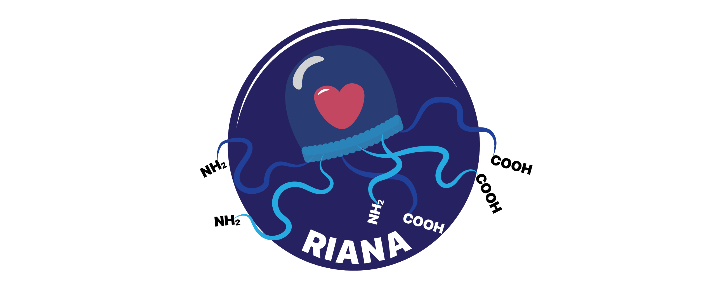
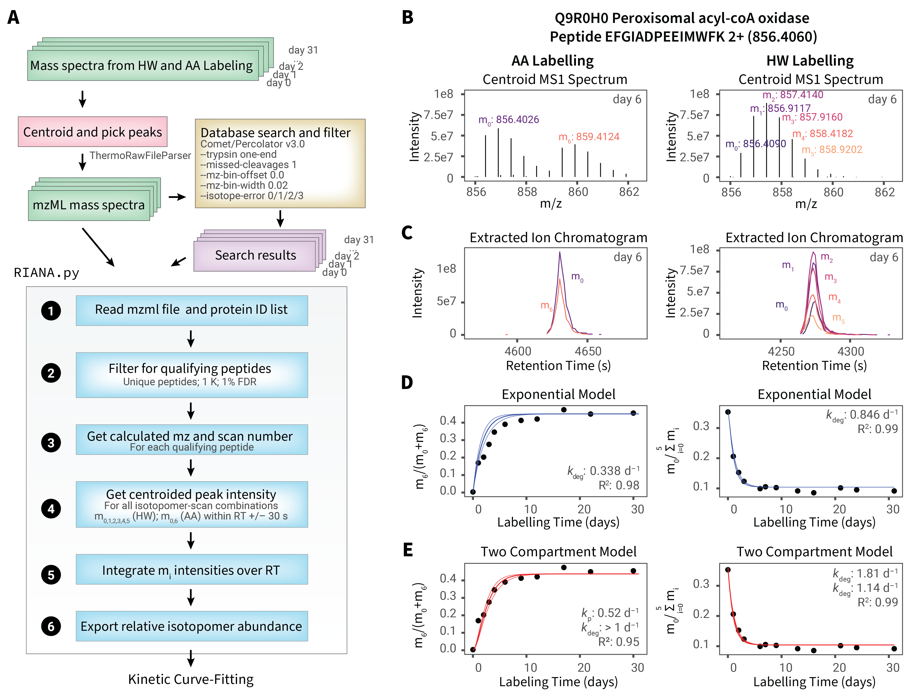

- [Edward Lau Lab](https://laulab.net), University of Colorado School of Medicine
- [Maggie Lam Lab](https://maggielab.org), University of Colorado School of Medicine

## About RIANA

RIANA (**R**elative **I**sotope **A**bundance A**na**lyzer) measures protein turnover from mass
spectrometry experiments with metabolic stable-isotope labeling. It integrates each peptide's MS1
isotopomer envelope, solves the fraction of newly synthesized protein at each labeling time, fits a
kinetic model for the turnover rate constant, and rolls peptides up to proteins.

- **Labels:** heavy water (D~2~O) and ^18^O water, each with its own labeling-site tables.
- **Identifications** come from established upstream tools: **quantms** mzTab (DDA) or **DIA-NN**
  `report.parquet` (DIA), described by an **SDRF** sample sheet. A Percolator file serves a single run.
- **Designs:** labeling time series, single-timepoint and multiplexed labeling (TMT/TMTpro, dimethyl),
  several conditions, and several tissues from the same animals.
- **Statistics:** a per-protein turnover difference between two conditions (Δk) with
  Benjamini–Hochberg adjustment, and, for tissues of the same animals, a test of whether that
  difference varies between tissues, with a random animal effect.
- **Interfaces:** a `integrate → fit → rollup` command line and a desktop app (`riana gui`) over
  the same engine.

## Downloads

::: {.column-margin}
**Latest Updates**

v1.2.0 (in development)
--
* Single-timepoint and multiplexed labeling (TMT/TMTpro, dimethyl).
* Weighted Δk model; tissue-by-tissue comparisons; an interaction test with a random animal effect.
* Standalone desktop app bundle.

v1.1.0
--
* ^18^O water fitting; newer D~2~O labeling-site tables.
* Default curation gates (labeling-site floor, rollup R² ≥ 0.8).

> See [Change Log](change.qmd) for details.

:::
RIANA is installed from PyPI (`pip install riana`); the source code is on GitHub:
<https://github.com/ed-lau/riana>.

See the [Quick Start](install.qmd) to set up a project, the [Documentation](about.qmd) for how each
step works, and the [CLI Reference](reference.qmd) for every option.

## Contributors
* Edward Lau, PhD - [ed-lau](https://github.com/ed-lau)
* Maggie Lam, PhD - [Maggie-Lam](https://github.com/Maggie-Lam)
* Jordan Currie, MSc - [jordancurrie](https://github.com/jordancurrie)

## Citations

If you use RIANA or the associated methods in your research, please consider citing the following papers:

Original publication, heavy water and SILAC comparison:

1. **Harmonizing Labeling and Analytical Strategies to Obtain Protein Turnover Rates in Intact Adult Animals**
Hammond DE, Simpson DM, Franco C, Wright Muelas M, Waters J, Ludwig RW, Prescott MC, Hurst JL, Beynon RJ, Lau E. *Molecular & Cellular Proteomics* 2022;21(7):100252. [doi:10.1016/j.mcpro.2022.100252](https://doi.org/10.1016/j.mcpro.2022.100252) Epub 2022 May 28. PMID: 35636728; PMCID: PMC9249856.

Rule-based mass isotopomer selection method for heavy water:

2. **Improved Method to Determine Protein Turnover Rates with Heavy Water Labeling by Mass Isotopomer Ratio Selection**
Currie J, Ng DCM, Pandi B, Black A, Manda V, Durham C, Pavelka J, Lam MPY, Lau E. *Journal of Proteome Research* 2025 Apr 4;24(4):1992-2005. [doi:10.1021/acs.jproteome.4c01012](https://doi.org/10.1021/acs.jproteome.4c01012) Epub 2025 Mar 18. PMID: 40100644; PMCID: PMC11977540.

Application of heavy water labeling to cell culture:

3. **Deuterium Labeling Enables Proteome Wide Turnover Kinetics Analysis in Cell Culture**
Alamillo L, Ng DCM, Currie J, Black A, Pandi B, Manda V, Pavelka J, Schaal P, Travers JG, McKinsey TA, Lam MPY, Lau E. *Cell Reports Methods* 2025 Jul 21;5(7):101104. [doi:10.1016/j.crmeth.2025.101104](https://doi.org/10.1016/j.crmeth.2025.101104) Epub 2025 Jul 10. PMID: 40645189; PMCID: PMC12296481.

Protocol for cell culture:

4. **Protocol to Measure Protein Half-Life in Cell Culture Using Heavy Water**
Alamillo L, et al. *STAR Protocols* 2026. [doi:10.1016/j.xpro.2026.104426](https://doi.org/10.1016/j.xpro.2026.104426)
